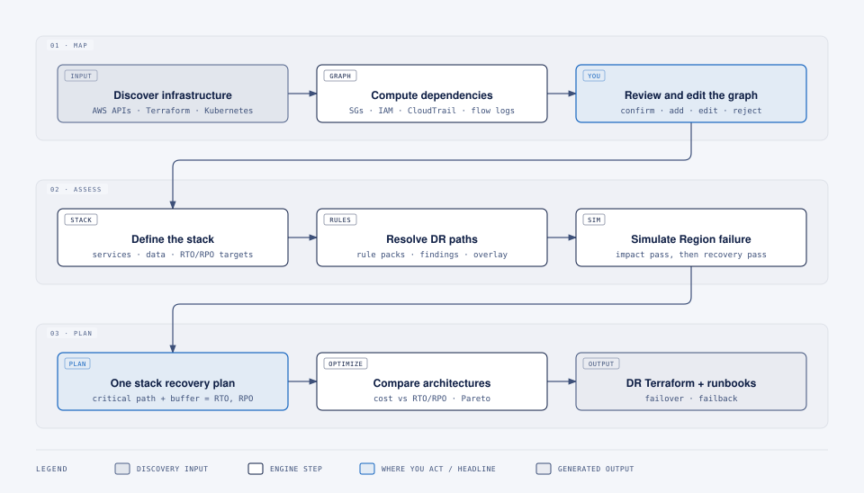

<p align="center">
  
</p>

<h1 align="center">Perpetual</h1>

<p align="center">
  <b>Find the gaps in your AWS disaster recovery, and fix them in your own code.</b>
</p>

<p align="center">
  
  
  
  
</p>

---

Perpetual makes a product on AWS able to survive losing its Region, within the RTO, RPO and budget you promised.

It looks at the whole **stack**: every microservice, database, network, load balancer, secret and key the product needs. It maps how they depend on each other, simulates the Region going down, and shows what breaks and why. Then it designs the DR setup that meets your targets and changes your Terraform and Kubernetes manifests to build it. You get a pull request, checked by the same simulation that found the problem.

## The problem

Most teams find out whether their DR plan works during the outage.

**Plans go stale.** A DR plan is written once and maybe tested once a year. In between, someone adds a service that reads a queue that only exists in the primary Region, turns off image replication to save money, or points a role at a primary-Region KMS key. Nothing fails until the day you fail over.

**Resources pass, stacks fail.** Most checks look at one resource at a time: is the database Multi-AZ, are backups on, is the bucket versioned. A healthy database replica in the DR Region still doesn't help if:

- the container image was never copied to the DR Region;
- a secret or KMS key exists only in the primary Region;
- the DR role's policy still points at a primary-Region ARN;
- a StatefulSet needs an EBS StorageClass and the DR cluster has no EBS CSI driver;
- the DR Region's Fargate quota is too low to run the services;
- DNS failover needs someone to edit records or change IAM during the outage.

Multi-AZ doesn't cover this either. It protects you from losing a data centre, not a Region.

**Nobody has the real dependency map.** Architecture diagrams show what was intended. The actual dependencies are spread across security groups, IAM policies, environment variables, Kubernetes manifests and the traffic your services really send.

**The RTO is a guess.** "30 minutes" is usually a target, not something anyone calculated. Adding up restore times per component gets it wrong both ways: some steps run in parallel, while detection, the decision to fail over, handoffs between people and final checks add time nobody counts.

**Fixing it is slow, careful work.** Even when the gaps are known, closing them means changes across many Terraform modules and manifests, in the right order, without breaking production. So it waits for the next quarter.

## How it works

<picture>
  <source media="(prefers-color-scheme: dark)" srcset="assets/how-it-works-dark.svg">
  
</picture>

**1. Map.** Perpetual reads your infrastructure from AWS APIs, Terraform and, optionally, Kubernetes. It works out the dependencies from three kinds of evidence:

| Evidence | Sources | Tells you |
|---|---|---|
| Permitted | security groups, NetworkPolicies, IAM policies | the connection is allowed |
| Referenced | Terraform, task definitions, ConfigMaps | the configuration names it |
| Observed | CloudTrail, VPC Flow Logs | it actually happens |

You review the graph, confirm or reject links, and add the ones it missed. Your edits are kept across rescans.

**2. Assess.** Group resources into a stack and set its targets. Rule packs check every resource and the links between them, and an LLM reviewer looks for what the rules miss, such as config that quietly ties a service to the primary Region. Then Perpetual simulates losing the Region and traces every failure to its cause.

**3. Fix.** Perpetual builds one recovery plan for the whole stack and calculates its RTO from the slowest chain of steps, with decisions, handoffs and validation shown as separate lines. It compares DR designs, from backup-and-restore to hot standby, plus mixes an LLM planner proposes using AWS guidance and your own runbooks. Every design is scored by the engine on cost, RTO and RPO. You approve one, and Perpetual changes your Terraform and manifests to build it, checks the result by simulating again, and opens a pull request.

## LLM proposes, engine verifies

LLMs are good at reading your code and AWS documentation and proposing changes. They are not a source of truth. So in Perpetual:

- every number you see (cost, RTO, RPO, durations) comes from the engine, never from a model;
- an LLM suggestion can flag a risk, but it can never mark something as safe. That takes the engine or you;
- a code change is offered only after the engine has re-run the assessment and simulation on the planned infrastructure and the stack meets its targets. Otherwise it is clearly labeled unverified;
- every suggestion cites what it is based on: a resource, a file and line, a document or a skill.

Agents run on LangGraph and use a local knowledge base (AWS DR guidance plus your runbooks and standards) and versioned **skills**, which are reviewed recipes for each DR technique such as a cross-Region RDS replica or ECR replication. The model provider is your choice: OpenRouter, Anthropic, Bedrock or a local model through Ollama, with a different model per role if you like.

## Example result

```text
Stack             checkout
Primary Region    ap-south-1  ->  DR Region ap-south-2

                  Today        After proposed change
Status            NOT READY    READY
RTO (target 30m)  74-110m      21-29m
RPO (target 5m)   UNKNOWN      1-3m
DR cost / month   $0           $640

Blocking findings fixed
1. checkout-api image unavailable in DR ECR       -> ECR replication rule
2. DR execution role cannot decrypt the KMS key   -> multi-Region key + policy
3. Database recovery exceeds the RTO              -> cross-Region read replica

Pull request      perpetual/dr/checkout/2026-11-02  (7 files, verified)
```

## Guarantees

- **Code only.** Perpetual edits Terraform and Kubernetes manifests on a separate branch. It never runs `terraform apply` or `kubectl apply`, never merges, and never changes your AWS accounts. Your review and your pipeline apply the change.
- **No guessing.** Missing evidence is `UNKNOWN`, never a pass. A stack isn't shown as DR-ready until you've reviewed the dependencies and open suggestions that result relies on.
- **Every answer has a reason.** Findings, dependencies and suggestions all show their evidence.
- **Your data stays yours.** Perpetual runs on your machine. LLM features are opt-in per project, every call is logged, and Terraform state, secret values, environment values and raw logs are never sent to a model.

## Scope

**First release covers:**

- ECS stacks: Route 53, ALB, ECS on Fargate, ECR, Secrets Manager, KMS, RDS, S3, VPC networking;
- EKS stacks: clusters, node groups, add-ons, IRSA and Pod Identity, persistent volumes on EBS;
- code changes to Terraform, plain Kubernetes manifests, Kustomize overlays and Helm values.

**Checked but not counted in the RTO:** monitoring, logging and CI/CD.

**Not planned for the first release:** other clouds, applying changes, automatic failover, automated DR drills, CloudFormation/CDK/Pulumi, a hosted version.

## Running it

Perpetual is a local tool. One command starts it:

```bash
uv tool install perpetual
perpetual ui          # opens on http://localhost:8000
```

It uses your existing AWS credentials. Everything is also available from the CLI:

```bash
perpetual scan --profile production --region ap-south-1 --dr-region ap-south-2
perpetual graph --stack checkout --unreviewed
perpetual simulate checkout --failure region:ap-south-1
perpetual optimize checkout --rto 30m --rpo 5m --budget 1200
perpetual dr-spec checkout --approve
perpetual transform checkout --terraform ./infra/prod --k8s ./deploy/prod --open-pr
```

These commands are planned; see Status below.

## Status

Perpetual is pre-alpha: the design is complete and implementation is starting. Development is engine-first, ECS before EKS:

| Phase | Delivers |
|---|---|
| P0–P1 | Data model, dependency graph, simulator and recovery planning, run from the CLI on test fixtures |
| P1b | Terraform import, local web UI, graph editor |
| P2–P3 | Live AWS scanning, CloudTrail and flow-log evidence, stack grouping |
| P3b | LLM foundation: providers, LangGraph, knowledge base, skills, guardrails |
| P4–P6 | DR rules and advisory review, simulation and recovery plans on real accounts |
| P7 | EKS support |
| P8–P9 | RPO, cost, DR design with LLM-proposed candidates, DR spec |
| P10 | Changing your Terraform and manifests, with verification and pull requests |
| P11–P12 | Runbooks, first release |

## Tech stack

Python 3.13 with FastAPI, Pydantic, SQLAlchemy, NetworkX and boto3, storing data in SQLite. Agents use LangGraph with any LangChain-supported model. The UI is React with React Flow, built into static files that the Python process serves.

## Documents

- [`spec.md`](spec.md): what Perpetual does, in detail.
- [`IMPL_PLAN.md`](IMPL_PLAN.md): how it gets built, phase by phase.
- [`TRACKER.md`](TRACKER.md): progress and decisions.
