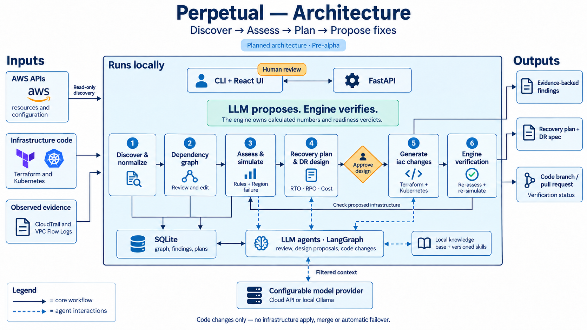

<p align="center">
  
</p>

<h1 align="center">Perpetual</h1>

<p align="center">
  <b>Find the gaps in your AWS disaster recovery, and fix them in your own code.</b>
</p>

<p align="center">
  
  
  
  
</p>

---

Perpetual is a local AWS disaster recovery (DR) tool designed to find what would break during a Region outage and propose fixes in your own infrastructure code.

It evaluates the whole **stack**: the services, databases, networking, secrets and keys a product needs to serve its users. The goal is to recover within three constraints:

- **Recovery time objective (RTO):** how long the product can be unavailable.
- **Recovery point objective (RPO):** how much recent data the product can afford to lose.
- **Budget:** how much the DR setup can cost.

> **Pre-alpha — implementation is starting.** This repository currently contains the specification, implementation plan and design assets. The capabilities and commands below describe the planned product.

## What Perpetual will do

- **Map dependencies** from AWS, Terraform and optional Kubernetes evidence.
- **Find DR gaps** across the stack, including dependencies on the primary Region.
- **Simulate a Region outage** and trace failures to their causes.
- **Build one recovery plan** with stack-level RTO, RPO and cost estimates.
- **Compare DR designs** against your recovery targets and budget.
- **Propose code changes** in Terraform and Kubernetes manifests, verified by re-simulation and delivered as a pull request.

## Why stack-level DR matters

Individual resources can pass their checks while the product still cannot recover:

- **Plans drift.** New services, queues and configuration changes quietly invalidate yesterday's DR plan.
- **Dependencies get missed.** A database replica is little help if the container image, secret or KMS key is unavailable in the DR Region.
- **Permissions and capacity block recovery.** IAM policies may still reference the primary Region, or DR quotas may be too low to run the services.
- **Kubernetes readiness is incomplete.** A StatefulSet may need an EBS StorageClass while the DR cluster lacks the EBS CSI driver.
- **Recovery estimates omit work.** Detection, failover decisions, manual handoffs and final validation all add time; other steps can run in parallel.
- **Fixes span repositories and resources.** Closing a gap can require coordinated changes across Terraform modules and deployment manifests.

Multi-AZ protects against Availability Zone failures; it does not provide recovery from losing an entire Region.

## How it works



### 1. Map the stack

- Read infrastructure from AWS APIs, Terraform and, optionally, Kubernetes.
- Build a dependency graph from three kinds of evidence:

| Evidence | Sources | What it establishes |
|---|---|---|
| Permitted | Security groups, NetworkPolicies, IAM policies | A connection is allowed |
| Referenced | Terraform, task definitions, ConfigMaps | Configuration names a dependency |
| Observed | CloudTrail, VPC Flow Logs | An interaction actually happens |

- Review the graph, confirm or reject links, and add missing dependencies.
- Keep your graph edits across rescans.

### 2. Assess recovery readiness

- Group resources into a stack and set its RTO, RPO and budget.
- Check resources and their dependencies with DR rule packs.
- Use an optional LLM reviewer to flag risks the rules may miss, such as configuration tied to the primary Region.
- Simulate losing the Region and trace each failure to its cause.

### 3. Plan and propose fixes

- Build one recovery plan for the stack, including decisions, handoffs and validation.
- Calculate RTO from the slowest chain of recovery steps.
- Compare designs from backup-and-restore to hot standby, including combinations proposed by an LLM planner using AWS guidance and your runbooks.
- Score each design with the engine against cost, RTO and RPO targets.
- After you approve a design, generate changes to your Terraform and Kubernetes manifests.
- Re-run assessment and simulation, then deliver the changes as a pull request with their verification status.

## LLM proposes, engine verifies

LLMs are good at reading your code and AWS documentation and proposing changes. They are not a source of truth. So in Perpetual:

- every number you see (cost, RTO, RPO, durations) comes from the engine, never from a model;
- an LLM suggestion can flag a risk, but it can never mark something as safe. That takes the engine or you;
- a code change is offered only after the engine has re-run the assessment and simulation on the planned infrastructure and the stack meets its targets. Otherwise it is clearly labeled unverified;
- every suggestion cites what it is based on: a resource, a file and line, a document or a skill.

The planned agent setup supports:

- **LangGraph workflows** for advisory review, DR design and code changes.
- **A local knowledge base** with AWS DR guidance, your runbooks and standards.
- **Versioned skills:** reviewed recipes for techniques such as cross-Region RDS replicas and ECR replication.
- **Provider choice:** OpenRouter, Anthropic, Bedrock or local models through Ollama, with a different model per role if needed.

## Example result

Illustrative output for a checkout stack; these are sample values, not measured results.

```text
Stack             checkout
Primary Region    ap-south-1  ->  DR Region ap-south-2

                  Today        After proposed change
Status            NOT READY    READY
RTO (target 30m)  74-110m      21-29m
RPO (target 5m)   UNKNOWN      1-3m
DR cost / month   $0           $640

Blocking findings fixed
1. checkout-api image unavailable in DR ECR       -> ECR replication rule
2. DR execution role cannot decrypt the KMS key   -> multi-Region key + policy
3. Database recovery exceeds the RTO              -> cross-Region read replica

Pull request      perpetual/dr/checkout/2026-11-02  (7 files, verified)
```

## Design guarantees

- **Code only.** Perpetual edits Terraform and Kubernetes manifests on a separate branch. It never runs `terraform apply` or `kubectl apply`, never merges, and never changes your AWS accounts. Your review and your pipeline apply the change.
- **No guessing.** Missing evidence is `UNKNOWN`, never a pass. A stack isn't shown as DR-ready until you've reviewed the dependencies and open suggestions that result relies on.
- **Every answer has a reason.** Findings, dependencies and suggestions all show their evidence.
- **Your data stays yours.** Perpetual runs on your machine. LLM features are opt-in per project, every call is logged, and Terraform state, secret values, environment values and raw logs are never sent to a model.

## Scope

**First release covers:**

- ECS stacks: Route 53, ALB, ECS on Fargate, ECR, Secrets Manager, KMS, RDS, S3, VPC networking;
- EKS stacks: clusters, node groups, add-ons, IRSA and Pod Identity, persistent volumes on EBS;
- code changes to Terraform, plain Kubernetes manifests, Kustomize overlays and Helm values.

**Checked but not counted in the RTO:** monitoring, logging and CI/CD.

**Outside the first release:**

- Other clouds or a hosted version.
- Applying infrastructure changes, automatic failover or automated DR drills.
- Code changes to CloudFormation, CDK or Pulumi.

## Planned usage

These commands are a preview of the intended interface and are not available yet.

The planned installation and local UI workflow is:

```bash
uv tool install perpetual
perpetual ui          # opens on http://localhost:8000
```

The tool will use your existing AWS credentials. The planned CLI workflow is:

```bash
perpetual scan --profile production --region ap-south-1 --dr-region ap-south-2
perpetual graph --stack checkout --unreviewed
perpetual simulate checkout --failure region:ap-south-1
perpetual optimize checkout --rto 30m --rpo 5m --budget 1200
perpetual dr-spec checkout --approve
perpetual transform checkout --terraform ./infra/prod --k8s ./deploy/prod --open-pr
```

## Status

Perpetual is pre-alpha: the design is complete and implementation is starting. Development is engine-first, ECS before EKS:

| Phase | Delivers |
|---|---|
| P0–P1 | Data model, dependency graph, simulator and recovery planning, run from the CLI on test fixtures |
| P1b | Terraform import, local web UI, graph editor |
| P2–P3 | Live AWS scanning, CloudTrail and flow-log evidence, stack grouping |
| P3b | LLM foundation: providers, LangGraph, knowledge base, skills, guardrails |
| P4–P6 | DR rules and advisory review, simulation and recovery plans on real accounts |
| P7 | EKS support |
| P8–P9 | RPO, cost, DR design with LLM-proposed candidates, DR spec |
| P10 | Changing your Terraform and manifests, with verification and pull requests |
| P11–P12 | Runbooks, first release |

## Tech stack

- **Runtime and API:** Python 3.13, FastAPI and Pydantic.
- **Dependency graph:** NetworkX.
- **AWS discovery:** boto3.
- **Local storage:** SQLite with SQLAlchemy.
- **Agents:** LangGraph with LangChain-supported models.
- **UI:** React and React Flow, built as static files served by the Python process.

## Documents

- [`spec.md`](spec.md): what Perpetual does, in detail.
- [`IMPL_PLAN.md`](IMPL_PLAN.md): how it gets built, phase by phase.
- [`TRACKER.md`](TRACKER.md): progress and decisions.
