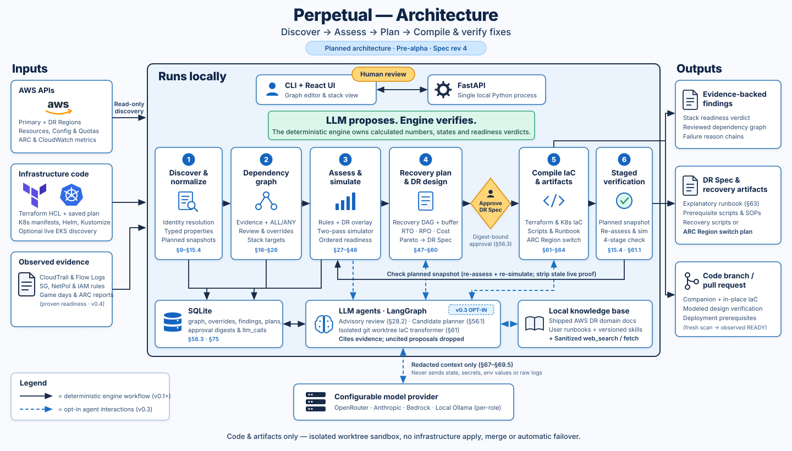

<p align="center">
  
</p>

<h1 align="center">Perpetual</h1>

<p align="center">
  <b>Find the gaps in your AWS disaster recovery, and fix them in your own code.</b>
</p>

<p align="center">
  
  
  
  
</p>

---

Perpetual is a local AWS disaster recovery (DR) tool designed to find what would break during a Region outage and propose fixes in your own infrastructure code.

It evaluates the whole **stack**: the services, databases, networking, secrets and keys a product needs to serve its users. The goal is to recover within three constraints:

- **Recovery time objective (RTO):** how long the product can be unavailable.
- **Recovery point objective (RPO):** how much recent data the product can afford to lose.
- **Budget:** how much the DR setup can cost.

> **Pre-alpha — milestone M0 (proof of concept) complete; M1 Alpha next.** Graph construction, DR rule packs, Region-outage simulation, recovery planning (with RTO/RPO math), and the PoC compile loop (`perpetual graph`, `perpetual simulate`, `perpetual plan`, `perpetual poc fix`) run locally on canonical fixtures today. Progress is tracked in [TRACKER.md](TRACKER.md). Live AWS discovery arrives in M1 Alpha and the local web UI in M2 MVP.

## What Perpetual will do

- **Map dependencies** from AWS, Terraform and optional Kubernetes evidence.
- **Find DR gaps** across the stack, including dependencies on the primary Region.
- **Simulate a Region outage** and trace failures to their causes.
- **Build one recovery plan** with stack-level RTO, RPO and cost estimates.
- **Compare DR designs** against your recovery targets and budget.
- **Propose code changes** in Terraform and Kubernetes manifests, verified by re-simulation and delivered as a pull request.

## Why stack-level DR matters

Individual resources can pass their checks while the product still cannot recover:

- **Plans drift.** New services, queues and configuration changes quietly invalidate yesterday's DR plan.
- **Dependencies get missed.** A database replica is little help if the container image, secret or KMS key is unavailable in the DR Region.
- **Permissions and capacity block recovery.** IAM policies may still reference the primary Region, or DR quotas may be too low to run the services.
- **Kubernetes readiness is incomplete.** A StatefulSet may need an EBS StorageClass while the DR cluster lacks the EBS CSI driver.
- **Recovery estimates omit work.** Detection, failover decisions, manual handoffs and final validation all add time; other steps can run in parallel.
- **Fixes span repositories and resources.** Closing a gap can require coordinated changes across Terraform modules and deployment manifests.

Multi-AZ protects against Availability Zone failures; it does not provide recovery from losing an entire Region.

## How it works



### 1. Map the stack

- Read infrastructure from AWS APIs, Terraform and, optionally, Kubernetes.
- Build a dependency graph from three kinds of evidence:

| Evidence | Sources | What it establishes |
|---|---|---|
| Permitted | Security groups, NetworkPolicies, IAM policies | A connection is allowed |
| Referenced | Terraform, task definitions, ConfigMaps | Configuration names a dependency |
| Observed | CloudTrail, VPC Flow Logs | An interaction actually happens |

- Review the graph, confirm or reject links, and add missing dependencies.
- Keep your graph edits across rescans.

### 2. Assess recovery readiness

- Group resources into a stack and set its RTO, RPO and budget.
- Check resources and their dependencies with DR rule packs.
- Use an optional LLM reviewer to flag risks the rules may miss, such as configuration tied to the primary Region.
- Simulate losing the Region and trace each failure to its cause.

### 3. Plan and propose fixes

- Build one recovery plan for the stack, including decisions, handoffs and validation.
- Calculate RTO from the slowest chain of recovery steps.
- Compare designs from backup-and-restore to hot standby, including combinations proposed by an LLM planner using AWS guidance and your runbooks.
- Score each design with the engine against cost, RTO and RPO targets.
- After you approve a design, generate changes to your Terraform and Kubernetes manifests.
- Re-run assessment and simulation on the proposed design, then deliver the changes with their verification status and deployment prerequisites. A fresh scan after deployment establishes observed readiness.

## LLM proposes, engine verifies

LLM features arrive in v0.3 (`M4 Agents`); v0.1 (`M2 MVP`) and v0.2 (`M3 Expansion`) are fully deterministic.

LLMs are good at reading your code and AWS documentation and proposing changes. They are not a source of truth. So in Perpetual:

- every number you see (cost, RTO, RPO, durations) comes from the engine, never from a model;
- an LLM suggestion can flag a risk, but it can never mark something as safe. That takes the engine or you;
- a design is marked verified only when the engine evaluates the planned infrastructure against its targets, with explicit assumptions and deployment prerequisites. Static checks alone cannot establish design verification, and design verification cannot establish observed readiness;
- every suggestion cites what it is based on: a resource, a file and line, a document or a skill.

The planned agent setup supports:

- **LangGraph workflows** for advisory review, DR design and code changes.
- **A local knowledge base** with shipped DR domain knowledge for all in-scope AWS services, AWS DR guidance, your runbooks and standards—plus controlled `web_search` and `web_fetch` tools so when an unmodeled or out-of-scope resource appears, the agent can fetch official documentation, persist and index it into the local knowledge base to improve the local docs, and cite it during DR planning.
- **Versioned skills:** reviewed recipes for techniques such as cross-Region RDS replicas and ECR replication.
- **Provider choice:** OpenRouter, Anthropic, Bedrock or local models through Ollama, with a different model per role if needed.

## Example result

Illustrative output for a checkout stack; these are sample values, not measured results.

```text
Stack             checkout
Primary Region    ap-south-1  ->  DR Region ap-south-2

                  Today        After proposed change
Status            NOT READY    Design meets targets
RTO (target 30m)  74-110m      21-29m
RPO (target 5m)   UNKNOWN      1-3m
DR cost / month   $0           $640

Blocking findings fixed
1. checkout-api image unavailable in DR ECR       -> ECR replication rule
2. DR execution role cannot decrypt the KMS key   -> multi-Region key + policy
3. Database recovery exceeds the RTO              -> cross-Region read replica

Pull request      perpetual/dr/checkout/2026-11-02  (7 files, design verified)
Deployment        Pending; fresh scan required for observed READY
```

## Design guarantees

- **Code only.** Perpetual edits Terraform and Kubernetes manifests on a separate branch. Repository tools run in an isolated environment with restricted credentials and network access. It never runs `terraform apply` or `kubectl apply` or merges. Your review and your pipeline apply the change.
- **No guessing.** Missing evidence is `UNKNOWN`, never a pass. A stack isn't shown as DR-ready until you've reviewed the dependencies and open suggestions that result relies on.
- **Every answer has a reason.** Findings, dependencies and suggestions all show their evidence.
- **Your data stays yours.** Perpetual runs on your machine. LLM features are opt-in per project, every call is logged, and Terraform state, secret values, environment values and raw logs are never sent to a model.

## Scope

**First release (`v0.1`, M2 MVP) covers:**

- ECS + RDS stacks end-to-end: `ECS on Fargate/EC2`, `RDS/Aurora`, `S3`, `ECR`, `Secrets Manager`, `SSM Parameter Store`, `KMS`, `IAM`, `ALB/NLB`, `Route 53`, `ACM`, `CloudWatch Logs` (scope-aware), and `VPC` networking;
- CloudTrail-only observed dependency evidence (`P2b`), a read-only React Flow graph viewer with review/confirm/reject (structural graph edits live in YAML overrides `P0-10`), and preset-based DR comparison (`StaticCostProvider` + Backup/Restore, Pilot Light, Warm Standby);
- companion Terraform for new DR resources and suggested edits by Terraform address for resources your Terraform already manages, verified with a supplied saved plan and delivered on a branch or PR;
- failover and failback runbooks, prerequisite scripts, and laptop-run Python recovery scripts.

**Post-v0.1 expansion (`v0.2`, M3) and agents (`v0.3`, M4):**

- `v0.2` adds expanded AWS services (`EC2/ASG`, `Lambda`, `SQS/SNS`, `CloudFront`, `WAF`, `EBS/EFS`, `DynamoDB`), `EKS` stacks (clusters, node groups, add-ons, IRSA, Pod Identity, EBS/EFS PVs), VPC Flow Logs + time-aware ENI resolution + ambiguous candidate-set review UI, interactive structural graph editing in the UI, full combinatorial Optimizer search + `AWSPricingProvider`, and the ARC Region switch plan compiler;
- `v0.3` adds LLM advisory review, candidate planning, and in-place edits to Terraform, plain Kubernetes manifests, Kustomize overlays, and Helm values inside an isolated runner.

**Checked but not counted in the RTO:** monitoring, logging and CI/CD.

**Outside the first release:**

- Other clouds or a hosted version.
- Applying infrastructure changes, automatic failover or automated DR drills.
- Code changes to CloudFormation, CDK or Pulumi.

## Try the M0 PoC demo

You can run the end-to-end M0 proof of concept locally against the bundled `ecs-broken` fixture (no AWS account required):

```bash
uv sync
uv run perpetual graph --fixture ecs-broken
uv run perpetual simulate --fixture ecs-broken
uv run perpetual plan --fixture ecs-broken
uv run perpetual poc fix --fixture ecs-broken --out /tmp/perpetual-poc
```

`perpetual poc fix` simulates `ecs-broken` (baseline `NOT_READY`), applies the modeled DR change set (multi-Region KMS key, ECR replication, cross-Region RDS read replica), renders companion Terraform under `/tmp/perpetual-poc/terraform/` plus a standalone resumable Python failover script at `/tmp/perpetual-poc/runbooks/failover.py`, and re-simulates the planned topology to confirm `DESIGN_MEETS_TARGETS`.

## Planned usage

These commands are a preview of the intended interface and are not available yet.

The planned installation and local UI workflow is:

```bash
uv tool install perpetual
perpetual ui          # opens on http://localhost:8000
```

The tool will use your existing AWS credentials. The planned CLI workflow is:

```bash
perpetual scan --profile production --region ap-south-1 --dr-region ap-south-2
perpetual graph --stack checkout --unreviewed
perpetual simulate checkout --failure region:ap-south-1
perpetual optimize checkout --rto 30m --rpo 5m --budget 1200
perpetual dr-spec checkout --approve
perpetual transform checkout --terraform ./infra/prod --k8s ./deploy/prod --open-pr
```

## Status

Perpetual is pre-alpha: M0 PoC is complete and M1 Alpha (live AWS discovery for ECS + RDS) is next. Development is engine-first and CLI-first, ECS + RDS before EKS and expanded services:

| Milestone | Delivers |
|---|---|
| M0 PoC | Graph, simulator and recovery planning on test fixtures, plus a first generated fix and recovery script |
| M1 Alpha | CLI-only ECS + RDS slice (`perpetual scan -> simulate -> plan`) on real AWS accounts with CloudTrail evidence, stacks, DR rules, RTO and RPO |
| v0.1 (M2 MVP) | Terraform saved-plan import, local web UI (read-only React Flow viewer + review/confirm/reject), preset DR design (`StaticCostProvider`), companion Terraform + suggested edits as a PR, runbooks, prerequisite scripts and Python recovery scripts. Fully deterministic. |
| v0.2 (M3 Expansion) | Expanded AWS services (`EC2/ASG`, `Lambda`, `SQS/SNS`, `CloudFront`, `WAF`, `EBS/EFS`, `DynamoDB`), `EKS` stacks, VPC Flow Logs + ambiguous review UI, interactive structural graph editor in UI, combinatorial Optimizer + `AWSPricingProvider`, and ARC Region switch plan compiler. Still deterministic. |
| v0.3 (M4 Agents) | LLM advisor, planner and in-place edits to your Terraform and manifests in an isolated runner |
| v0.4 (M5 Proven) | Proven readiness from game days and ARC execution reports; drift |
| v1.0 (M6 Production) | Packaged, upgradeable, audited release with a published service matrix |

## Tech stack

- **Runtime and API:** Python 3.13, FastAPI and Pydantic.
- **Dependency graph:** NetworkX.
- **AWS discovery:** boto3.
- **Local storage:** SQLite with SQLAlchemy.
- **Agents:** LangGraph with LangChain-supported models.
- **UI:** React and React Flow, built as static files served by the Python process.

## Documents

- [`spec.md`](spec.md) & [`docs/spec/`](docs/spec/): architecture overview, reader's guide, section index, and the 7 modular specification documents (`§1`–`§109`).
- [`IMPL_PLAN.md`](IMPL_PLAN.md): how it gets built, phase by phase.
- [`TRACKER.md`](TRACKER.md): progress and decisions.

- [`docs/code/`](docs/code/README.md): living code wiki—concepts, architecture, package walkthroughs, and worked flows for readers with basic Python knowledge.
